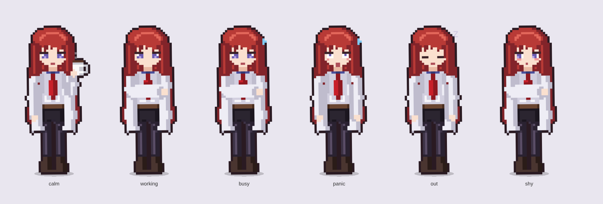

# kurisu-limits

Мод для Claude Code: пиксельная Курису Макисе живёт в панели рядом с чатом и следит за лимитами Claude.



## Что умеет

- Полоски лимитов подписки: 5 часов и неделя, с процентами и временем до сброса.
- Заполненность контекста и стоимость сессии.
- Короткая сводка лимитов в статус-строке.
- Курису реагирует на происходящее:
  - **спокойна** (лимиты < 60%) — пьёт кофе, дышит, моргает;
  - **работает** (Claude отвечает) — скрестила руки и подпрыгивает;
  - **напряглась** (≥ 60%) — капля пота;
  - **паника** (≥ 85%) — трясётся;
  - **лимит кончился** — спит;
  - назовёшь её «Кристиной» или «ассистенткой» — смутится.
- Всплывашки на 60%, 85% и 100%.
- Команда `/kurisu` снова открывает панель.

В приложении Claude (десктоп, веб, мобильное, VS Code) спрайт рисуется SVG с CSS-анимацией. В терминале — цветными полублоками, анимация по таймеру.

Лимиты приходят только на подписке Claude (Pro / Max). С API-ключом панель покажет контекст и стоимость.

## Установка

В терминальной сессии Claude Code:

```
/plugin install kurisu-limits --marketplace lannettanastemi/kurisu
```

Из шелла:

```bash
claude plugin install kurisu-limits --marketplace lannettanastemi/kurisu
```

В десктопном приложении: «+» рядом с полем ввода → Plugins → Add marketplace → `lannettanastemi/kurisu` → Add plugin.

## Разработка

```bash
claude plugin validate .
claude plugin test .
```

Спрайт собирается в `hooks/sprite.ts` из фигур (многоугольники и эллипсы), контур и тени считаются автоматически. Позы и лица настроений — там же.

Курису Макисе — персонаж Steins;Gate (© MAGES./Nitroplus). Это фанатский мод, пиксель-арт нарисован с нуля.
