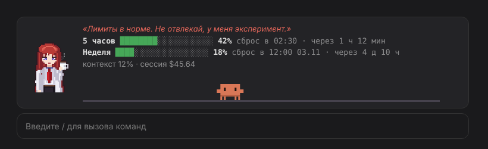

# kurisu-limits

Мод для Claude Code: полоска над полем ввода, где пиксельная Курису Макисе следит за лимитами Claude, а пиксельный Клод занимается своими делами.



## Что показывает

- Лимиты подписки за 5 часов и неделю: полоска, проценты, во сколько сброс и сколько до него осталось.
- Заполненность контекста и стоимость сессии.
- Короткую сводку лимитов в статус-строке, всплывашки на 60%, 85% и 100%.

## Курису


- **спокойна** (лимиты < 60%) — пьёт кофе, дышит, моргает;
- **работает** (Claude отвечает) — скрестила руки и подпрыгивает;
- **напряглась** (≥ 60%) — капля пота;
- **паника** (≥ 85%) — трясётся;
- **лимит кончился** — спит;
- назовёшь её «Кристиной» или «ассистенткой» — смутится.

## Клод

Живёт на дорожке под лимитами:

- без дела бегает туда-сюда, прыгает, садится отдохнуть, моргает и пускает сердечко;
- пока Claude отвечает, сидит за ноутбуком и печатает;
- когда лимит почти кончился, носится в панике;
- когда кончился — спит.

## Управление

`/kurisu` прячет полоску и показывает её обратно. Полоску можно свернуть кнопкой `[-]`.

Полоска над полем ввода есть в терминале и в десктопном приложении. В приложении персонажи рисуются SVG с CSS-анимацией, в терминале — цветными полублоками по таймеру. В узком терминале Курису прячется, остаются лимиты и Клод.

Лимиты приходят только на подписке Claude (Pro / Max) и обновляются после ответов и раз в минуту. С API-ключом видны только контекст и стоимость.

## Установка

В терминальной сессии Claude Code:

```
/plugin install kurisu-limits --marketplace lannettanastemi/kurisu
```

Из шелла:

```bash
claude plugin install kurisu-limits --marketplace lannettanastemi/kurisu
```

В десктопном приложении: «+» рядом с полем ввода → Plugins → Add marketplace → `lannettanastemi/kurisu` → Add plugin.

## Разработка

```bash
claude plugin validate .
claude plugin test .
```

Курису собирается в `hooks/sprite.ts` из фигур (многоугольники и эллипсы), контур и тени считаются автоматически. Клод и его занятия — в `hooks/clawd.ts`.

Курису Макисе — персонаж Steins;Gate (© MAGES./Nitroplus). Клод — маскот Claude (© Anthropic). Это фанатский мод, пиксель-арт нарисован с нуля.
